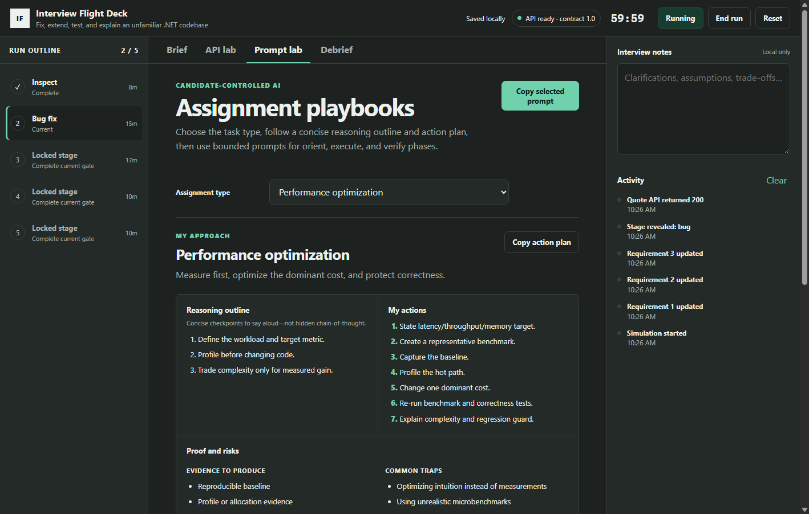

# Interview Flight Deck

A local, deterministic trainer for **AI-assisted coding interviews**, paired with a real C#/.NET practice codebase.

The application runs a structured 60-minute simulation in which you inspect an unfamiliar repository, fix a bug, implement a feature, harden edge cases, run real checkpoints, and prepare a technical walkthrough. It is designed to develop judgment and AI supervision—not prompt-and-hope behavior.



## What is included

- **Interactive interview cockpit** with a persistent timer, staged requirements, stage gates, local notes, activity history, prompt templates, and self-scoring.
- **Real ASP.NET Core API** for checkout quote calculations.
- **Real API lab** in the browser; requests pass through the running HTTP pipeline.
- **Deterministic checkpoints** that run predefined probes against the C# domain implementation.
- **Practice starter state** created in an isolated Git worktree so `main` remains green.
- **39 bounded AI prompt templates** across 13 assignment types, each with a concise reasoning outline, step-by-step candidate actions, evidence requirements, traps, and a spoken interviewer update.
- **15 .NET tests** plus eight browser-state/content tests and JavaScript syntax checks.
- **GitHub Actions CI**, Dependabot configuration, security policy, and architecture documentation.

No account, cloud service, AI key, analytics, remote font, database, or Docker installation is required.

## Screens and workflow

1. **Brief** — current objective, checkable requirements, focused commands, and checkpoint evidence.
2. **API lab** — edit and send a real `POST /api/v1/quotes` request.
3. **Assignment playbooks** — choose among unfamiliar codebases, bugs, features, refactoring, testing, API integration, performance, security, code review, data migration, frontend/UI, async/concurrency, and CLI automation. Each includes orient, execute, and verify prompts.
4. **Debrief** — factual run summary, checkpoint count, and a seven-dimension self-assessment.

Only the current stage is actionable. Completing every visible requirement unlocks the next stage. The timer is timestamp-derived and survives refreshes.

## Prerequisites

- [.NET SDK 10.0.301](https://dotnet.microsoft.com/)
- Git
- A modern browser
- Node.js only for the small browser-state test suite

## Run the completed trainer

```bash
dotnet restore
dotnet run --project src/Practice.Api --urls http://127.0.0.1:5187
```

Open <http://127.0.0.1:5187>.

The API and trainer are served from one loopback origin. Progress and notes stay in browser `localStorage`.

## Start a genuine practice attempt

The repository's `main` branch is the completed reference implementation. Create an isolated worktree containing the deliberately incomplete starter:

### Windows PowerShell

```powershell
./scripts/start-exercise.ps1
```

### Bash

```bash
./scripts/start-exercise.sh
```

The script:

1. Requires a clean main checkout.
2. Creates `../ai-interview-practice` as a detached worktree.
3. Installs the behavioral starter version of `QuoteCalculator.cs`.
4. Verifies that the project still builds.

Then, from the generated worktree:

```bash
dotnet test
dotnet run --project src/Practice.Api --urls http://127.0.0.1:5187
```

The build is expected to succeed while behavior tests fail. Use the trainer to work through the failures without looking at the completed implementation on `main`.

## The assignment

### Scenario

The checkout quote endpoint accepts basket lines, shipping, and an optional promotion code. It returns subtotal, discount, shipping, total, and stable applied-rule identifiers.

### Rules

- `SAVE10` discounts merchandise only, never shipping.
- `BULK5` gives 5% off each SKU line whose quantity is at least three.
- The total `BULK5` discount is capped at $15.
- Quantity must be between 1 and 99.
- Empty baskets are rejected.
- Money uses `decimal` and rounds to two places away from zero.
- Invalid requests produce structured HTTP 400 responses.

### 60-minute structure

| Stage | Time | Exit condition |
|---|---:|---|
| Inspect | 8 min | Identify contract, domain owner, and baseline |
| Bug fix | 15 min | `SAVE10` regression test changes from red to green |
| Feature | 17 min | `BULK5` threshold and cap pass |
| Edge cases | 10 min | Validation and rounding boundaries pass |
| Review | 10 min | Full suite passes and trade-offs are explained |

## Useful API request

```bash
curl -X POST http://127.0.0.1:5187/api/v1/quotes \
  -H 'Content-Type: application/json' \
  -d '{
    "lines": [{ "sku": "BOOK", "quantity": 2, "unitPrice": 20 }],
    "shipping": 10,
    "promotionCode": "SAVE10"
  }'
```

Expected total: `46.00`.

## Verification

### Windows

```powershell
./scripts/verify.ps1
```

### Bash

```bash
./scripts/verify.sh
```

The verification path runs:

```text
dotnet restore
dotnet build
dotnet test
npm test
npm run check
```

## Repository structure

```text
src/Practice.Domain/         Business rules
src/Practice.Api/            ASP.NET API + static trainer
src/Practice.Api/wwwroot/    Browser cockpit
 tests/                      Domain and HTTP integration tests
web-tests/                   Browser-state reducer tests
exercise/starter/            Deliberately incomplete domain implementation
scripts/                     Verification and worktree tooling
docs/                        Architecture and exercise runbook
```

## Honest product boundaries

- The prompt lab prepares and records prompts but does not contact an AI provider.
- Checkpoints verify predefined code behavior; they do not semantically grade free text.
- The trainer cannot observe editor changes or shell output. Test results shown by checkpoints are actual in-process probes, not fabricated terminal runs.
- Because this is a public learning repository, the reference solution is visible on `main`. The worktree workflow provides isolation, not secrecy.

## Documentation

- [Architecture](docs/architecture.md)
- [Exercise runbook](docs/exercise-runbook.md)
- [Security policy](SECURITY.md)
- [Contributing](CONTRIBUTING.md)

## License

MIT
